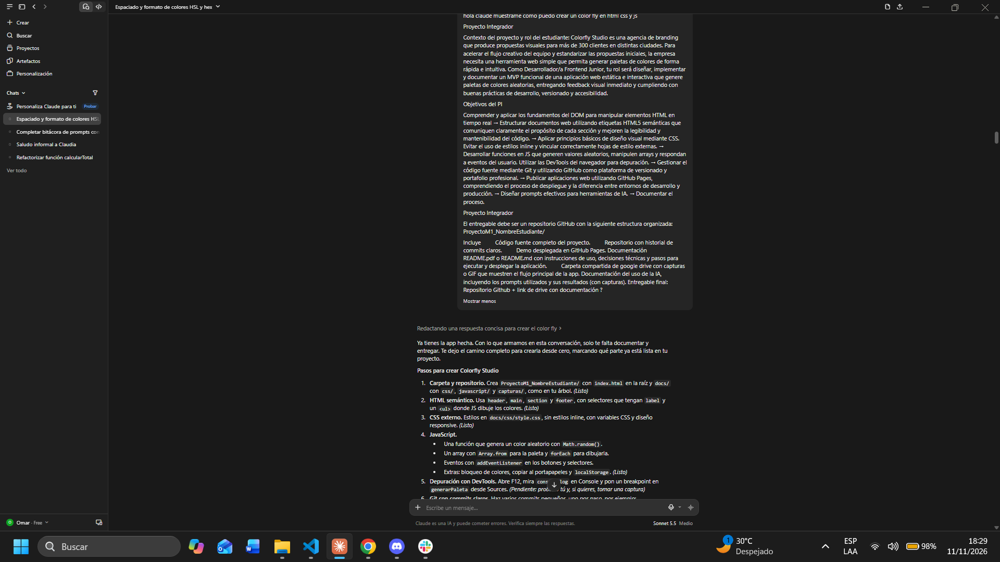
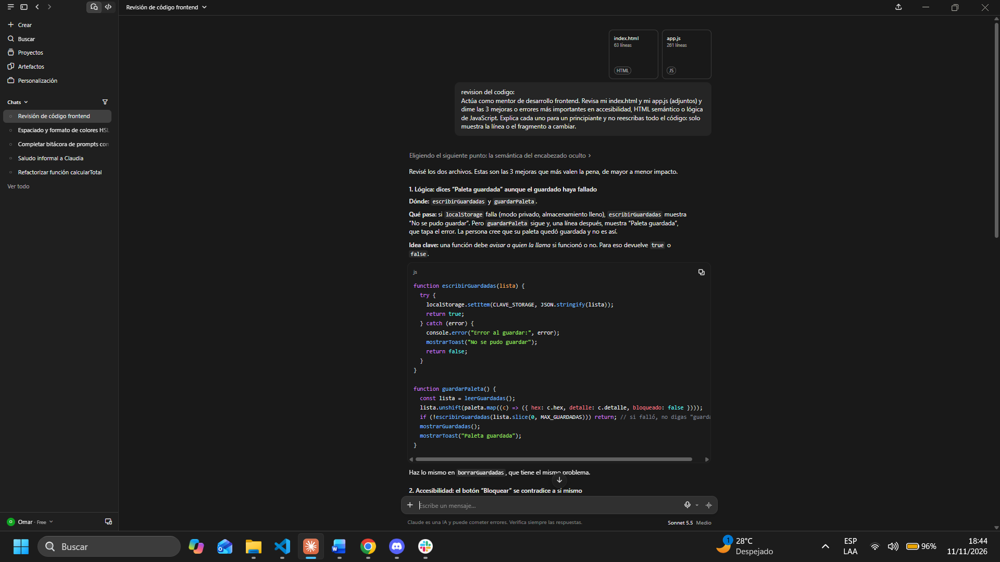
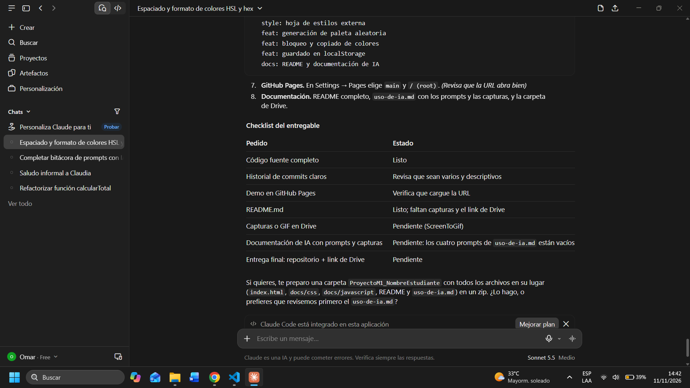
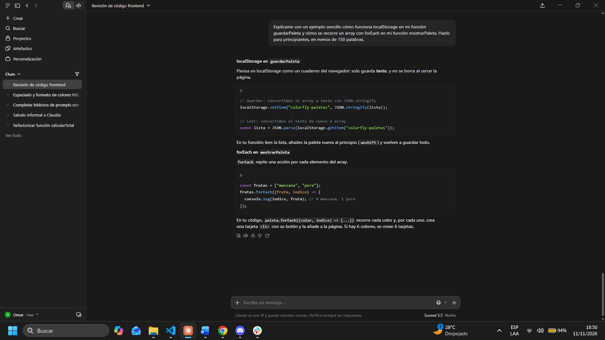
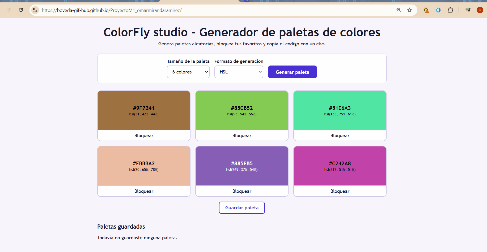

# Colorfly Studio · Generador de paletas (MVP)
 
## Índice
- [Descripción](#descripción)
  - [Funcionalidades](#funcionalidades)
- [Link del Deploy](#link-del-deploy)
- [Instrucciones de uso y ejecución local](#instrucciones-de-uso-y-ejecución-local)
  - [Estructura](#estructura)
  - [Cómo usar la app](#cómo-usar-la-app)
- [Pasos para realizar el despliegue](#pasos-para-realizar-el-despliegue)
- [Decisiones técnicas](#decisiones-técnicas)
- [Mejoras](#mejoras)
- [Documentación IA (capturas de prompts)](#documentación-ia-capturas-de-prompts)
- [Flujo de la app (capturas o gif)](#flujo-de-la-app-capturas-o-gif)
## Descripción
<p align="justify">Aplicación web estática que genera paletas de colores aleatorios para propuestas de branding. Permite elegir el tamaño de la paleta (6, 8 o 9 colores) y el formato de color (HSL, HEX o RGBA). Está hecha con HTML, CSS y JavaScript puro, sin librerías.</p>
### Funcionalidades
- Botón "Generar paleta".
- Selector de tamaño: 6, 8 o 9 colores (el render cambia dinámicamente).
- Selector de formato: HSL, HEX o RGBA. Cada cuadro muestra un solo código, en el formato elegido.
- Bloqueo de colores: se mantienen al generar otra paleta.
- Copiar el código visible al hacer clic sobre un color.
- Guardado de paletas en `localStorage` (hasta 8) y carga con un clic.
- Microfeedback con un toast al generar, copiar, bloquear y guardar.
- Animación sutil de aparición, desactivada con `prefers-reduced-motion`.
## Link del Deploy
 
https://boveda-gif-hub.github.io/ProyectoM1_omarmiranda/
 
## Instrucciones de uso y ejecución local
 
**Ejecución local**
1. Clona el repositorio:
```
   git clone https://github.com/boveda-gif-hub/ProyectoM1_omarmiranda.git
```
2. Entra a la carpeta del proyecto.
3. Abre `index.html` en el navegador (doble clic). No necesita instalar nada.
   Opcional: usa la extensión Live Server de VS Code para recargar al guardar.
### Estructura
 
```
├── index.html
├── README.md
└── docs/
    ├── capturas/
    ├── css/
    │   └── style.css
    ├── js/
    │   └── app.js
    └── uso-de-ia.md
```
 
### Cómo usar la app
1. Elige el tamaño de la paleta y el formato de color.
2. Pulsa "Generar paleta".
3. Pulsa "Bloquear" en los colores que quieras conservar y vuelve a generar.
4. Haz clic en un color para copiar su código.
5. Pulsa "Guardar paleta" para guardarla; haz clic en una paleta guardada para cargarla.
6. "Borrar todas" elimina las paletas guardadas.
## Pasos para realizar el despliegue
1. Sube el proyecto a GitHub:
```
   git init
   git add .
   git commit -m "feat: estructura HTML semántica"
   git branch -M main
   git remote add origin https://github.com/boveda-gif-hub/ProyectoM1_omarmiranda.git
   git push -u origin main
```
2. En el repositorio, ve a **Settings → Pages**.
3. En **Source** elige la rama `main` y la carpeta `/ (root)`, y pulsa **Save**.
4. Espera uno o dos minutos y abre la URL publicada.
**Desarrollo vs producción:** en desarrollo abres el archivo en tu equipo; en producción cualquiera accede por una URL pública.
 
## Decisiones técnicas
- **JavaScript puro, sin librerías:** es un MVP simple y sirve para practicar los fundamentos del DOM (`createElement`, `appendChild`, `addEventListener`).
- **Colores como botones:** son accesibles por teclado y permiten copiar el código con un clic.
- **Tres formatos:** cada color se guarda como HEX y se convierte a HSL o RGBA solo al mostrarlo, así que cambiar de formato no altera la paleta.
- **Array como estado:** `paleta` guarda los colores (se crea con `Array.from`) y `forEach` los dibuja.
- **Variables CSS:** el JS entrega el color y el CSS controla el diseño, evitando estilos inline en el HTML.
- **Texto con contraste automático:** se calcula la luminosidad del fondo para elegir blanco o negro.
- **Accesibilidad:** `lang="es"`, `label` asociado a cada selector con `for`/`id`, foco visible, `aria-pressed` en el botón de bloqueo y toast con `aria-live`.
- **Archivos en la raíz:** `index.html` y `README.md` están en la raíz porque GitHub Pages sirve `index.html` desde ahí; el CSS, el JS, las capturas y la documentación de IA van en `docs/`.
- **Depuración:** `console.log` muestra la paleta en la pestaña Console de DevTools, y se pueden poner breakpoints en `generarPaleta` desde Sources.
## Mejoras
- Exportar la paleta como imagen o archivo (CSS, JSON).
- Mostrar el ratio de contraste de cada color según WCAG.
- Generar paletas armónicas (complementarios, análogos, triádicos).
- Poder poner nombre a las paletas guardadas y borrarlas una por una.
- Compartir una paleta mediante un enlace.
## Documentación IA (capturas de prompts)
El detalle de los prompts y resultados está en [`docs/uso-de-ia.md`](docs/uso-de-ia.md).
 
Prompt de ejemplo:
> Actúa como mentor de desarrollo frontend. Necesito un generador de paletas de colores aleatorios en HTML, CSS y JS puro, con HTML semántico, CSS externo sin estilos inline, manipulación de arrays y buena accesibilidad. Explica cada parte para principiantes.
 
**Por qué funcionó:** define el rol, la tecnología, las restricciones y el nivel del lector.
 
**Mejora posible:** pedir también casos de prueba y un listado de errores comunes.
 
**Capturas**
 




 
## Flujo de la app (capturas o gif)
