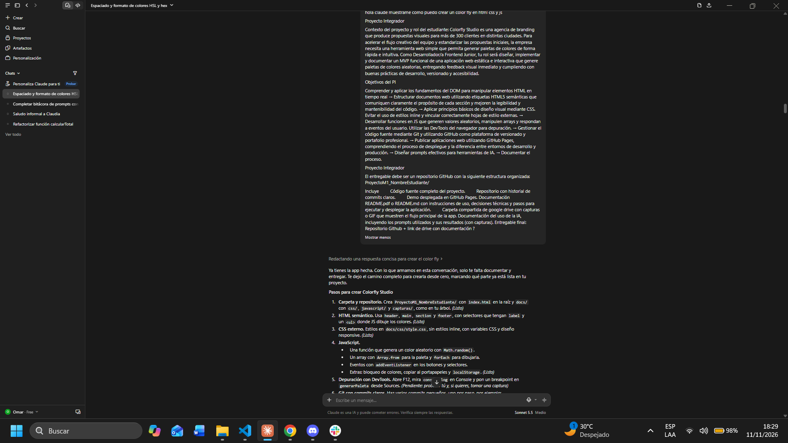
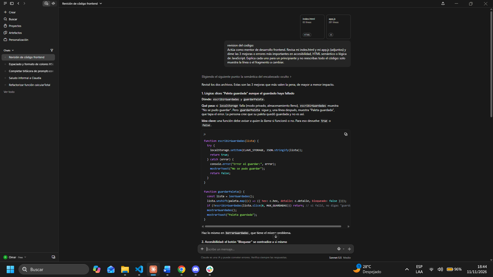
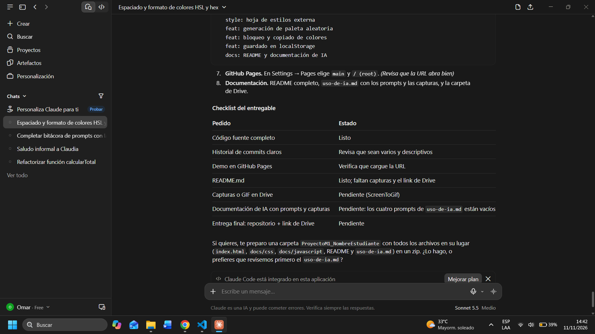
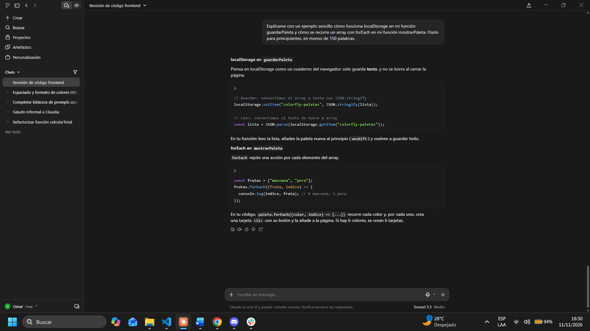

# Documentación del uso de la IA
 
**Herramienta:** Claude (Anthropic)
**Fecha:** 11/11/2026
 
## Resumen
Usé IA como mentor para generar la primera versión del MVP y luego la revisé, la probé y la adapté a los requisitos del proyecto.
 
## Prompt 1: Planteamiento del proyecto y consigna
**Prompt usado:**
> hola claude muéstrame como puedo crear un color fly en html css y js
>
> Proyecto Integrador
>
> Contexto del proyecto y rol del estudiante: Colorfly Studio es una agencia de branding que produce propuestas visuales para más de 300 clientes en distintas ciudades. Para acelerar el flujo creativo del equipo y estandarizar las propuestas iniciales, la empresa necesita una herramienta web simple que permita generar paletas de colores de forma rápida e intuitiva. Como Desarrollador/a Frontend Junior, tu rol será diseñar, implementar y documentar un MVP funcional de una aplicación web estática e interactiva que genere paletas de colores aleatorias, entregando feedback visual inmediato y cumpliendo con buenas prácticas de desarrollo, versionado y accesibilidad.
>
> Objetivos del PI
>
> Comprender y aplicar los fundamentos del DOM para manipular elementos HTML en tiempo real → Estructurar documentos web utilizando etiquetas HTML5 semánticas que comuniquen claramente el propósito de cada sección y mejoren la legibilidad y mantenibilidad del código. → Aplicar principios básicos de diseño visual mediante CSS. Evitar el uso de estilos inline y vincular correctamente hojas de estilo externas. → Desarrollar funciones en JS que generen valores aleatorios, manipulen arrays y respondan a eventos del usuario. Utilizar las DevTools del navegador para depuración. → Gestionar el código fuente mediante Git y utilizando GitHub como plataforma de versionado y portafolio profesional. → Publicar aplicaciones web utilizando GitHub Pages, comprendiendo el proceso de despliegue y la diferencia entre entornos de desarrollo y producción. → Diseñar prompts efectivos para herramientas de IA. → Documentar el proceso.
>
> Proyecto Integrador
>
> El entregable debe ser un repositorio GitHub con la siguiente estructura organizada: ProyectoM1_NombreEstudiante/
>
> Incluye: Código fuente completo del proyecto. Repositorio con historial de commits claros. Demo desplegada en GitHub Pages. Documentación: README.pdf o README.md con instrucciones de uso, decisiones técnicas y pasos para ejecutar y desplegar la aplicación. Carpeta compartida de google drive con capturas o GIF que muestren el flujo principal de la app. Documentación del uso de la IA, incluyendo los prompts utilizados y sus resultados (con capturas). Entregable final: Repositorio Github + link de drive con documentación ?
 
**Resultado:** La IA me explicó paso a paso cómo crear Colorfly Studio (carpeta y repositorio, HTML semántico, CSS externo, JavaScript con arrays y eventos, DevTools, commits claros, GitHub Pages y documentación) y armó un checklist del entregable.
 
**Captura:**
 

 
## Prompt 2: Revisión del código
**Prompt usado:**
> revision del codigo:
> Actúa como mentor de desarrollo frontend. Revisa mi index.html y mi app.js (adjuntos) y dime las 3 mejoras o errores más importantes en accesibilidad, HTML semántico o lógica de JavaScript. Explica cada uno para un principiante y no reescribas todo el código: solo muestra la línea o el fragmento a cambiar.
 
**Resultado:** La IA revisó mis dos archivos y señaló las 3 mejoras más importantes. La primera fue un error de lógica: si `localStorage` falla, `guardarPaleta` igual mostraba "Paleta guardada" y tapaba el aviso de error. Propuso que `escribirGuardadas` devuelva `true` o `false` para que `guardarPaleta` sepa si el guardado funcionó, y apliqué ese cambio en `docs/js/app.js`. La segunda fue de accesibilidad, sobre el botón "Bloquear".
 
**Captura:**
 

 
## Prompt 3: Casos de prueba
**Prompt usado:**
> Dame una lista de casos de prueba para verificar mi generador de paletas: selector de tamaño (6, 8 y 9), formatos HSL, HEX y RGBA, bloqueo de colores, copiar código y guardar paletas. Preséntala en una tabla con las columnas: paso a realizar y resultado esperado.
 
**Resultado:** La IA entregó tablas de casos de prueba agrupadas por funcionalidad, con las columnas "Paso a realizar" y "Resultado esperado". Por ejemplo, al elegir 8 colores deben aparecer exactamente 8 tarjetas, y en formato HEX cada tarjeta muestra un código `#RRGGBB` en mayúsculas.
 
**Captura:**
 

 
## Prompt 4: Explicación de localStorage y forEach
**Prompt usado:**
> Explícame con un ejemplo sencillo cómo funciona localStorage en mi función guardarPaleta y cómo se recorre un array con forEach en mi función mostrarPaleta. Hazlo para principiantes, en menos de 150 palabras.
 
**Resultado:** La IA explicó que `localStorage` guarda solo texto: se convierte el array con `JSON.stringify` para guardarlo y con `JSON.parse` para leerlo. Con un ejemplo de frutas mostró cómo `forEach` repite una acción por cada elemento, y lo relacionó con mi código, donde `paleta.forEach` crea una tarjeta por cada color.
 
**Captura:**
 

 
## Reflexión
- **Qué funcionó bien:** hizo que las respuestas fueran más útiles, y pedir que me explicara el código me ayudó a entenderlo.
- **Qué tuve que corregir o verificar yo:** probar en DevTools, cambiar mi usuario de GitHub y corregir el aviso de guardado que señaló la revisión del código.
- **Qué aprendí:** cómo funciona localStorage y cómo recorrer arrays.
- **Cómo mejoraría mis prompts:** enviar todos los requisitos en un solo mensaje y ser más específico.